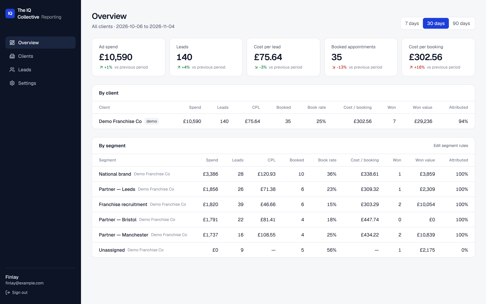

# IQC Reporting Dashboard

Lead and Meta Ads reporting for The IQ Collective's clients. It joins CRM leads (GoHighLevel now, Zoho next) to the Meta campaigns and ads that produced them, then rolls everything up by client and **segment** (a franchise partner, recruitment, national, and so on).



## Stack

- **Next.js 16** (App Router, TypeScript, Tailwind v4), hosted on **Vercel**
- **Supabase** (Postgres, Auth, row-level security), in an EU region
- Direct **Meta Marketing API** and **GHL API** syncs, run by Vercel Cron *(build steps 2–3)*

## How it fits together

```
Meta Marketing API ──► meta_campaigns / meta_ads / meta_insights_daily ─┐
                                                                         ├─► SQL views ─► dashboard
GHL (or Zoho) ──► CRM adapter ──► leads (one standard format) ──────────┘
```

- **Segments.** Campaigns map to segments via *rules*, e.g. "campaign name contains `| Leeds |`". The fallbacks are the ad account's default segment and then the client's default. This handles one shared franchise ad account as well as one ad account per segment.
- **Attribution.** Each lead is matched to a campaign using Meta IDs from lead forms or UTMs, or by `utm_campaign` name. See [docs/ATTRIBUTION.md](docs/ATTRIBUTION.md).
- **Stages.** Each CRM's stage names map onto one funnel (`new → contacted → qualified → booked → showed → won`, plus `lost` and `unqualified`) via `stage_mappings`, so GHL and Zoho report the same way.
- **CRM-agnostic.** Adapters in `src/lib/crm/` turn CRM records into `NormalizedLead`. Adding Zoho means writing one adapter.

Key SQL lives in `supabase/migrations/`: the views `campaign_segments`, `lead_attribution` and `segment_daily`.

## Setup

### 1. Supabase
1. Create a project at supabase.com and pick **London (eu-west-2)**.
2. In the SQL Editor, run `supabase/migrations/20261105000000_init.sql`.
3. *(Optional)* Run `supabase/seed.sql` to load a demo client. You can remove it later with `delete from clients where is_demo;`.
4. Under **Authentication → Sign In / Providers**, turn off **Allow new users to sign up**.
5. Under **Authentication → Users → Add user**, create your login. Then grant it access:
   ```sql
   insert into app_users (user_id, role, display_name)
   select id, 'admin', 'Finlay' from auth.users where email = 'you@theiqcollective.com';
   ```
   A user who can log in but isn't in `app_users` sees nothing (RLS) and gets a "no access" page.

### 2. Run locally
```bash
cp .env.example .env.local   # fill in Supabase URL + keys
npm install
npm run dev
```

### 3. Deploy (Vercel)
1. In Vercel, choose **Add New → Project**, import this GitHub repo, and keep the defaults.
2. Add the variables from `.env.example` under **Settings → Environment Variables**.
3. Under **Settings → Domains**, add e.g. `reports.theiqcollective.com`, then create the CNAME record Vercel shows you at your DNS provider.
4. In Supabase, set **Authentication → URL Configuration → Site URL** to that domain.

Commercial use needs Vercel **Pro**.

## Scripts

| | |
|---|---|
| `npm run dev` | Local dev server |
| `npm run build` | Production build |
| `npm run typecheck` | Generate route types and type-check |
| `npm test` | Unit tests (attribution parsing, metrics, date windows) |
| `npm run db:test` | Applies migrations and seed to a throwaway local Postgres, then checks segment resolution, attribution, totals and RLS |

With Docker you can also run the full local stack with `npx supabase start`.

## Roadmap

1. ✅ App scaffold, schema, auth, IQC branding, demo data
2. Meta sync: accounts, campaigns, ad sets, ads, daily ad-level insights, lead form leads
3. GHL adapter: contacts and opportunities sync, plus a new-lead webhook
4. Reporting: trend charts, campaign and ad breakdowns, editing segment rules and stage mappings in the UI
5. Deploy to the IQC subdomain
6. Zoho adapter, then the TFO rollout
